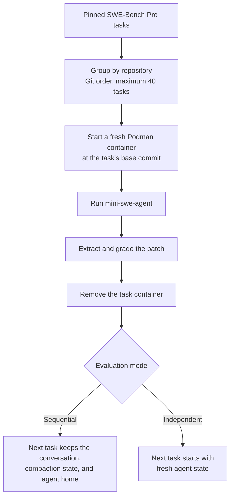

# SWE-Bench Pro Sequential

[](https://github.com/RomainFrog/swebenchpro-seq/actions/workflows/ci.yml)

Evaluate coding agents on ordered sequences of SWE-Bench Pro tasks.

Most coding benchmarks reset the agent after every issue. This benchmark asks
whether an agent can accumulate useful repository knowledge over time, while a
matching independent mode provides the fresh-state baseline.

Every task starts in a fresh Podman container at its specified Git commit. In
sequential mode, the agent keeps its conversation, compacted context, and
`/home/agent` files between tasks from the same repository. Independent mode
runs the same tasks with fresh agent state each time.

The canonical protocol is defined in [BENCHMARK.md](BENCHMARK.md). The runnable
path uses public packages, model APIs, benchmark data, evaluator code, and
rootless Podman.

## Quick start

You need Python 3.11+, [uv](https://docs.astral.sh/uv/), rootless
[Podman](https://podman.io/), and access to a supported model provider or
compatible endpoint.

Clone the repository and install its locked environment:

```bash
git clone https://github.com/RomainFrog/swebenchpro-seq.git
cd swebenchpro-seq
uv sync --frozen
```

On Linux with systemd, enable Podman's rootless API socket:

```bash
systemctl --user enable --now podman.socket
export DOCKER_HOST="unix://$XDG_RUNTIME_DIR/podman/podman.sock"
```

Then configure your model key and run the two-task end-to-end smoke test:

```bash
export OPENAI_API_KEY=...

uv run swebench-seq doctor --config public-smoke-responses-podman
uv run swebench-seq run --config public-smoke-responses-podman
```

The first run downloads the pinned dataset, evaluator, and required task
images. It can therefore take considerably longer than later runs.

Inspect and validate the result:

```bash
uv run swebench-seq report \
  --run-dir /tmp/swebench-seq-public-smoke/run_0
uv run swebench-seq validate-run \
  --run-dir /tmp/swebench-seq-public-smoke/run_0
```

A successful smoke has two completed predictions, two official scores, and no
infrastructure failures. It deliberately allows only one model call per task,
so empty patches, `LimitsExceeded`, and failing scores are expected. The smoke
tests the complete wiring rather than solve quality. See
[the smoke-test example](docs/SMOKE_EXAMPLE.md) for the expected output.

For Linux without systemd and for macOS, see [Podman setup](#podman-setup).

## What runs



The two modes differ only in what survives between tasks:

| Mode | Task checkout | Conversation and agent home | Parallelism |
| --- | --- | --- | --- |
| Sequential | Fresh `base_commit` for every task | Shared within one repository | Different repositories |
| Independent | Fresh `base_commit` for every task | Fresh for every task | Individual tasks |

Tasks from different repositories and repeated runs never share state.

## Run an evaluation

Three ready-to-run configurations are included:

| Configuration | Purpose | Default output |
| --- | --- | --- |
| `public-smoke-responses-podman` | Two-task sequential connectivity check | `/tmp/swebench-seq-public-smoke` |
| `sequential-responses-podman` | Canonical sequential evaluation | `runs/sequential-responses-podman` |
| `independent-responses-podman` | Matching independent baseline | `runs/independent-responses-podman` |

Run the full sequential benchmark:

```bash
uv run swebench-seq run --config sequential-responses-podman
```

Run the matching independent baseline:

```bash
uv run swebench-seq run --config independent-responses-podman
```

Preview the exact ordered task plan and sanitized configuration without
starting containers, calling a model, grading, or writing artifacts:

```bash
uv run swebench-seq run --config sequential-responses-podman --dry-run
```

The canonical suite contains up to 40 Git-ordered tasks from each of 11
repositories, for 420 tasks total. Use a smaller repository run while testing
your setup:

```bash
uv run swebench-seq run \
  --config public-smoke-responses-podman \
  --repo qutebrowser/qutebrowser \
  --limit 2 \
  --output-dir runs/qutebrowser-smoke
```

## Models and configuration

Bundled configurations live in
[`src/swebench_seq/configs`](src/swebench_seq/configs). Copy one when you need
to change the provider, model, endpoint, output directory, or context window.
Explicit CLI options override values from the YAML file.

The bundled smoke uses OpenAI's Responses API. For another OpenAI-compatible
Responses endpoint, copy the smoke configuration:

```bash
cp src/swebench_seq/configs/public-smoke-responses-podman.yaml ./my-smoke.yaml
```

Then edit its provider fields:

```yaml
provider: openai
api_key_env: MODEL_API_KEY
base_url: https://gateway.example/v1

model:
  model_name: your-model-id
  model_class: swebench_seq.agent.responses.OpenAIResponsesModel
  cost_tracking: ignore_errors
  model_kwargs:
    reasoning_effort: medium
    max_output_tokens: 16000
    bash_tool: true
    replay_encrypted_reasoning: true
```

Then run it exactly like a bundled configuration:

```bash
export MODEL_API_KEY=...
uv run swebench-seq doctor --config ./my-smoke.yaml
uv run swebench-seq run --config ./my-smoke.yaml
```

Anthropic and OpenRouter use mini-swe-agent's LiteLLM model adapter. Complete
examples and all supported configuration keys are documented in
[`src/swebench_seq/configs/README.md`](src/swebench_seq/configs/README.md).

Credentials are resolved on the host and are never passed into task or grading
containers. Standard environment variables are `OPENAI_API_KEY`,
`ANTHROPIC_API_KEY`, and `OPENROUTER_API_KEY`; `api_key_env` can name a custom
variable.

Use `uv run swebench-seq run --help` for every CLI option.

## Results and recovery

Each invocation records the resolved configuration, exact task ordering,
container-image identities, agent trajectories, patches, official scores, and
token usage beneath its configured output directory.

```bash
# Re-run official scoring for an existing run
uv run swebench-seq score --run-dir runs/example/run_0

# Print a human-readable or JSON summary
uv run swebench-seq report --run-dir runs/example/run_0
uv run swebench-seq report --run-dir runs/example/run_0 --format json

# Check completeness and reproducibility metadata
uv run swebench-seq validate-run --run-dir runs/example/run_0
```

Resume a sequential run from its first missing or failed task with the same
configuration and `--retry`:

```bash
uv run swebench-seq run --config sequential-responses-podman --retry
```

`--retry` restores the preceding conversation and agent-home snapshot; it does
not retry correctly completed tasks until they pass. `--skip-existing-patches`
is available for simpler artifact reuse.

See [docs/RESULTS.md](docs/RESULTS.md) for the artifact layout, metric
denominators, and publication checklist. Machine-readable schemas live in
[`schemas/`](schemas/).

## Podman setup

The harness uses the rootless Podman CLI for task containers. The official
evaluator talks to Podman's Docker-compatible API socket through the `docker`
Python package; it does not require a Docker daemon or Docker CLI.

Linux with systemd:

```bash
systemctl --user enable --now podman.socket
export DOCKER_HOST="unix://$XDG_RUNTIME_DIR/podman/podman.sock"
```

Linux without systemd—leave the service running in one terminal:

```bash
podman system service --time=0 unix:///tmp/podman.sock
```

Then use this in the evaluation terminal:

```bash
export DOCKER_HOST=unix:///tmp/podman.sock
```

macOS:

```bash
podman machine start
export DOCKER_HOST="unix://$(podman machine inspect \
  --format '{{.ConnectionInfo.PodmanSocket.Path}}')"
```

Linux with rootless Podman is the primary tested environment. Windows is not
currently tested.

Completed task containers are removed automatically. Images stay in Podman's
cache for reuse, and the harness never deletes pre-existing image tags. Disk
cleanup remains an explicit user operation such as `podman image prune`.

Ordinary `HTTP_PROXY`, `HTTPS_PROXY`, and `NO_PROXY` variables are honored and
forwarded to task containers. Advanced environment controls are:

- `SWEBENCH_PODMAN_COMMAND`: alternate Podman executable or wrapper;
- `SWEBENCH_ROLLOUT_PROXY`: proxy forwarded into task containers;
- `SWEBENCH_CONTAINER_PROXY`: fallback proxy for container operations;
- `SWEBENCH_ROLLOUT_NETWORK_MODE`: Podman network mode for task containers;
- `SWEBENCH_CONTAINER_NETWORK_MODE`: fallback container network mode;
- `SWEBENCH_PRO_EVALUATOR_DIR`: local evaluator checkout override.

Rollout containers use Podman's default network unless a rollout network mode
is set explicitly. Evaluator containers always run with network access blocked.
Proxy URLs are visible to code inside the rollout container, so avoid embedding
reusable credentials in them.

## Reproducibility and isolation

The default run uses pinned revisions of the public
[`ScaleAI/SWE-bench_Pro`](https://huggingface.co/datasets/ScaleAI/SWE-bench_Pro)
dataset and
[`scaleapi/SWE-bench_Pro-os`](https://github.com/scaleapi/SWE-bench_Pro-os)
evaluator. Both are downloaded into the user cache; the evaluator archive is
checksum-verified. `uv.lock` pins the Python environment.

For every task, the harness:

1. starts the task's published SWE-Bench Pro image;
2. resets `/app` to the task's declared `base_commit`;
3. removes untracked files and replaces Git history with a clean baseline;
4. runs the agent without exposing evaluator files, tests, or gold patches;
5. extracts `git diff HEAD` and grades it with the pinned evaluator; and
6. removes the task container even when the rollout or evaluator fails.

Run manifests distinguish pinned canonical inputs from a complete 420-task
run. Local datasets, evaluator checkouts, alternate image prefixes, subsets,
and debug limits are recorded as non-canonical or incomplete as appropriate.
Model sampling and remote provider implementations may still be
nondeterministic.

## Resource expectations

Start with the two-task smoke. A full run may require hundreds of gigabytes of
cached image layers, many hours or days, and substantial provider usage. Check
`podman system df` and the free-space line from `swebench-seq doctor` first.

Images are shared across runs, so reruns become much cheaper. On macOS,
allocate enough Podman VM disk and memory for the repositories you select.

## Architecture

The runtime path is:

```text
CLI → experiment config → run orchestration → task execution → Podman + agent/evaluator
      experiment.py       orchestration/run.py  execution.py    runner.py
                                                            agent/  evaluation/
```

`runner.py` owns task-container isolation. `agent/` owns mini-swe-agent,
conversation state, compaction, provider adapters, and persistent agent home.
`evaluation/` owns the pinned public dataset and evaluator boundary.

<details>
<summary>Repository layout</summary>

```text
src/swebench_seq/
├── cli.py               # operational commands
├── commands/run.py      # run options and CLI-to-service boundary
├── experiment.py        # experiment YAML and task-selector parsing
├── runner.py            # task-container lifecycle and Podman wrapper
├── agent/                # mini-swe-agent integration and persistent state
├── orchestration/       # planning, task execution, and recovery
├── evaluation/          # public benchmark data and grading boundary
├── tasks.py             # dataset loading, ordering, and grouping
├── manifest.py          # provenance and exact task plans
├── redaction.py         # credential and URL sanitization
├── predictions.py       # crash-safe prediction accumulation
└── configs/             # complete runnable configurations
```

</details>

## Development

```bash
uv sync --frozen --extra dev
uv run ruff check src tests
uv run mypy src
uv run pytest
uv build
```

CI tests Python 3.11 and 3.12, the provider-free workflow, live rootless
Podman, and installation from the built wheel. See
[CONTRIBUTING.md](CONTRIBUTING.md), [SECURITY.md](SECURITY.md), and the
[Code of Conduct](CODE_OF_CONDUCT.md).

## License

The harness is MIT licensed. External benchmark assets and dependencies retain
their own terms; see [LICENSE](LICENSE) and [NOTICE](NOTICE). Citation metadata
is available in [CITATION.cff](CITATION.cff).
