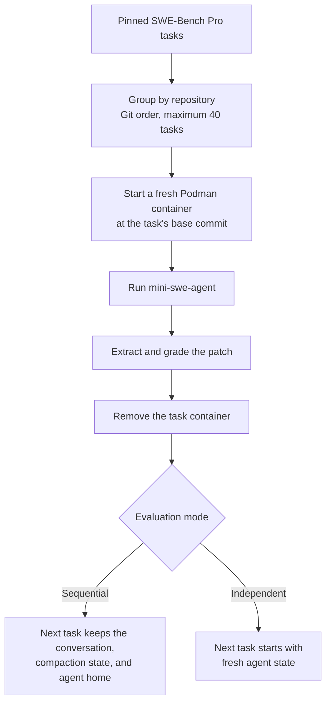

# SWE-Bench Pro Sequential

[](https://github.com/RomainFrog/swebench-pro-sequential/actions/workflows/ci.yml)

Evaluate coding agents on ordered sequences of SWE-Bench Pro tasks.

Most coding benchmarks reset the agent after every issue. Here the agent works
through each repository's tasks in Git-history order and keeps its
conversation, compacted context, and `/home/agent` files from one task to the
next. A matching independent mode runs the same tasks with fresh agent state as
the baseline.

Paper: [No Reset, Emergent Behaviors: Evaluating and Training Agents on
Sequences of Tasks](https://openreview.net/forum?id=CQ0nBBUvj2). The canonical
protocol is defined in [BENCHMARK.md](BENCHMARK.md).

## Quick start

You need Python 3.11+, [uv](https://docs.astral.sh/uv/), rootless
[Podman](https://podman.io/) (Linux is the tested platform), and access to a
model API.

```bash
git clone https://github.com/RomainFrog/swebench-pro-sequential.git
cd swebench-pro-sequential
uv sync --frozen

# Podman API socket (Linux with systemd; other setups: docs/PODMAN.md)
systemctl --user enable --now podman.socket
export DOCKER_HOST="unix://$XDG_RUNTIME_DIR/podman/podman.sock"

# Two-task end-to-end smoke test
export OPENAI_API_KEY=...
uv run swebench-seq doctor --config public-smoke-responses-podman
uv run swebench-seq run --config public-smoke-responses-podman
uv run swebench-seq validate-run --run-dir /tmp/swebench-seq-public-smoke/run_0
```

The smoke allows one model call per task, so empty patches and failing scores
are expected: it checks setup, containers, the model API, and state carryover,
not solve quality. Empty patches are scored without starting the evaluator. It
succeeds when it records two predictions, two scores, and no infrastructure
failures ([expected output](docs/SMOKE_EXAMPLE.md)).

The first run downloads the pinned dataset, evaluator, and task images into
your cache. A full run can need hundreds of gigabytes of images and many hours;
`swebench-seq doctor` reports free disk space.

## How it works



| Mode | Task checkout | Conversation and agent home | Parallelism |
| --- | --- | --- | --- |
| Sequential | Fresh `base_commit` for every task | Shared within one repository | Different repositories |
| Independent | Fresh `base_commit` for every task | Fresh for every task | Individual tasks |

Each task container starts at the task's `base_commit` with a clean Git history
and no access to tests, gold patches, or evaluator files. Tasks from different
repositories and repeated runs never share state.

## Run the benchmark

| Configuration | Purpose |
| --- | --- |
| `public-smoke-responses-podman` | Two-task connectivity check |
| `sequential-responses-podman` | Canonical sequential run: up to 40 tasks from each of 11 repositories (420 total) |
| `independent-responses-podman` | Matching independent baseline |

```bash
uv run swebench-seq run --config sequential-responses-podman
uv run swebench-seq run --config independent-responses-podman

# Print the ordered task plan without starting containers or calling a model
uv run swebench-seq run --config sequential-responses-podman --dry-run
```

The full runs write to `runs/<configuration>/`. CLI options override config
values; see `uv run swebench-seq run --help`.

## Use your own model

For any OpenAI-compatible Responses endpoint, copy a bundled configuration and
edit its `base_url`, `api_key_env`, and `model.model_name`:

```bash
cp src/swebench_seq/configs/public-smoke-responses-podman.yaml my-config.yaml
uv run swebench-seq run --config ./my-config.yaml
```

Anthropic and OpenRouter models run through mini-swe-agent's LiteLLM adapter;
the [configuration guide](src/swebench_seq/configs/README.md) has examples and
every supported key. Credentials stay on the host and are never passed into
task or grading containers.

## Results

```bash
uv run swebench-seq report --run-dir runs/sequential-responses-podman/run_0
uv run swebench-seq validate-run --run-dir runs/sequential-responses-podman/run_0
uv run swebench-seq score --run-dir runs/sequential-responses-podman/run_0  # re-grade
```

To resume an interrupted sequential run, repeat the same command with
`--retry`. It restores the conversation and agent home from just before the
first incomplete task, and never reruns a completed task just because its patch
failed the tests. [docs/RESULTS.md](docs/RESULTS.md) describes the artifacts
and metrics.

## Documentation

- [BENCHMARK.md](BENCHMARK.md): canonical protocol, pinned inputs, and leakage boundary
- [docs/RESULTS.md](docs/RESULTS.md): artifact layout, metrics, and what to publish
- [docs/PODMAN.md](docs/PODMAN.md): macOS and non-systemd setup, disk usage, proxies, and networking
- [Configuration guide](src/swebench_seq/configs/README.md): providers and every configuration key
- [CONTRIBUTING.md](CONTRIBUTING.md): development setup and architecture; see also
  [SECURITY.md](SECURITY.md) and the [Code of Conduct](CODE_OF_CONDUCT.md)

## License

The harness is MIT licensed. External benchmark assets and dependencies retain
their own terms; see [LICENSE](LICENSE) and [NOTICE](NOTICE).

## Citation

If you use this benchmark, please cite:

```bibtex
@inproceedings{froger2026no,
  title={No Reset, Emergent Behaviors: Evaluating and Training Agents on Sequences of Tasks},
  author={Romain Froger and Matteo Bettini and Theophile Laurent and Kavya Kopparapu and Gr{\'e}goire Mialon and Amine Benhalloum and Djam{\'e} Seddah and Thomas Scialom},
  booktitle={NeurIPS 2026 Workshop on Continual Learning in the Era of Foundation Models and Embodied Agents},
  year={2026},
  url={https://openreview.net/forum?id=CQ0nBBUvj2}
}
```
